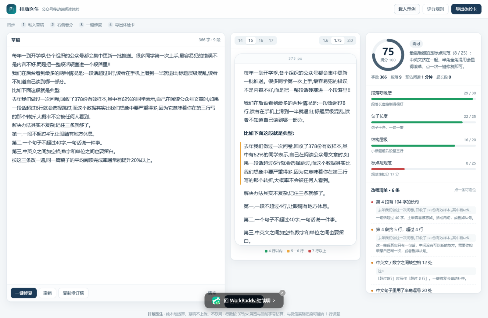
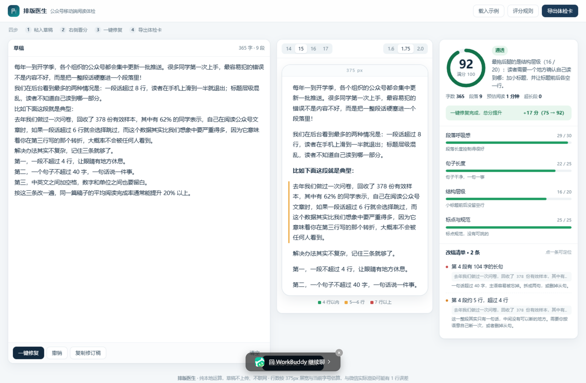

# 排版医生 · 公众号移动端阅读体检

把公众号草稿粘进去，算出**每一段在手机上到底占几行**，给出四维评分、逐条可定位的改稿清单，以及一个只整理格式、不改写语义的「一键修复」。

在线体验：<https://workbuddy.link/p/jbhmStKun7Y2C1rHGfz2HB>





## 为什么做这个

电脑屏幕上看着只有三行的段落，到了手机上可能是六行。读者划到第四行就开始走神，而作者几乎永远看不到这个瞬间——因为写作和阅读发生在两块不同的屏幕上。

排版医生把这个判断从「凭感觉」变成「可量化」：按 375px 屏宽与当前字号换算实际行数，4 行以内标绿、5—6 行标黄、7 行以上标红。写完推送、排完版、点群发之前，花三分钟自查一遍。

## 功能

| 功能 | 说明 |
| --- | --- |
| 行数可视化 | 按屏宽与字号换算每段行数，手机预览逐段着色 |
| 四维评分 | 段落呼吸感 30 + 句子长度 25 + 结构层级 20 + 标点与规范 25 |
| 改稿清单 | 每条问题定位到第几段，点击自动滚到对应位置 |
| 一键修复 | 中英文空格、半全角标点、连用感叹号、多余空行批量整理，并给出修复前后分差 |
| 体检卡导出 | Canvas 生成 1080×1400 的结果图片，可存档或分享 |
| 草稿记忆 | 草稿与字号偏好存本机 localStorage，刷新不丢 |

## 快速开始

### 方式一：直接打开

双击 `index.html`，或拖进浏览器。不需要安装依赖，不需要构建，不需要联网。

### 方式二：本地起服务（如需在手机上预览）

```bash
cd paiban-yisheng
python -m http.server 8000
# 浏览器打开 http://localhost:8000
# 手机与电脑同一局域网时，可用 http://<本机IP>:8000 在真机上验收
```

## 评分口径（摘要）

完整公式、阈值与扣分表见 [`docs/scoring-spec.md`](docs/scoring-spec.md)。

行数估算：可用宽度 = 375px − 左右各 16px 内边距 = 343px，除以当前字号得到每行的 em 容量（15px 时约 22.86 个汉字），英文与数字按半个汉字宽折算。

| 维度 | 分值 | 满分条件 |
| --- | --- | --- |
| 段落呼吸感 | 30 | 每段折算行数 ≤ 4 |
| 句子长度 | 25 | 每句 ≤ 30 字 |
| 结构层级 | 20 | 有小标题、段落 3—25 段、首段 ≤ 4 行、标题前后留空行 |
| 标点与规范 | 25 | 无中英混排空格缺失、无半全角混用、无连用标点 |

## 设计取舍

1. **单文件，不做工程化拆分。** 这个工具要发布到内容平台的静态托管上，单文件是部署成本最低的形态，也保证了「双击即用」。为此 CSS 与 JS 内联，外部依赖为零。
2. **机器只修格式，不替你改句子。** 自动修复不会在逗号处断开长段——那样会在段末留下半截逗号，也等于替你决定了语义。遇到「一整段其实是一句话」，工具只标出来，断句留给作者。
3. **ES5 语法。** 目标环境包含旧版 WebView，`const` / 箭头函数 / 模板字符串一律不用。
4. **所有动态文本走 `textContent`。** 不使用 `innerHTML` 拼接用户输入，避免 XSS。
5. **诚实标注误差。** 估算口径与微信真机渲染通常差 ±1 行，界面底部与文档都写明，不宣称精确。

## 目录结构

```
paiban-yisheng/
├── index.html                 # 应用本体（单文件，含内联样式与脚本）
├── README.md
├── CHANGELOG.md
├── LICENSE
├── .editorconfig
├── .gitignore
└── docs/
    ├── scoring-spec.md        # 评分算法、阈值与扣分表
    ├── submission-pack.md     # 「1024 造物挑战」投稿材料（表单字段、社媒文案）
    └── screenshots/           # 四张界面截图
```

## 技术栈与兼容性

- 原生 HTML / CSS / JavaScript，无框架、无依赖、无构建步骤。
- 使用 `localStorage`、`canvas.toDataURL`、`Element.closest`、`scrollIntoView`。
- 已在 Chromium 桌面端与 390px 移动视口验证：无控制台报错、无横向溢出、导出下载正常。

## 已知限制

- 行数是**估算**：微信实际渲染受机型、字体、字重影响，通常有 ±1 行误差，不能替代真机预览。
- 只处理纯文本。图片间距、卡片样式、秀米等第三方排版工具的容器内边距不在检测范围内。
- 「小标题」用启发式规则识别（编号开头、短句无句末标点、以冒号结尾），极短的正文段落可能被误判为标题。
- 不评价内容质量，只衡量阅读体验。

## 开发与验证

改动 `index.html` 后可跑两道静态检查（可选，需 Python）：

```bash
# 内联脚本语法
python -c "import re;h=open('index.html',encoding='utf-8').read();open('_c.js','w',encoding='utf-8').write(re.findall(r'<script>(.*?)</script>',h,re.S)[0])"
node --check _c.js && rm _c.js
```

自查清单：粘入示例 → 分数应为 75 → 点一键修复 → 应变为 92 且标点维度 25/25 → 点导出体检卡应下载 PNG。

## 竞赛背景

本项目为 WorkBuddy「1024 造物挑战」程序员节应用创作大赛参赛作品（投稿征集 2026-10-21 至 2026-11-01）。投稿材料与社媒文案见 [`docs/submission-pack.md`](docs/submission-pack.md)。

## 许可

[MIT](LICENSE)
